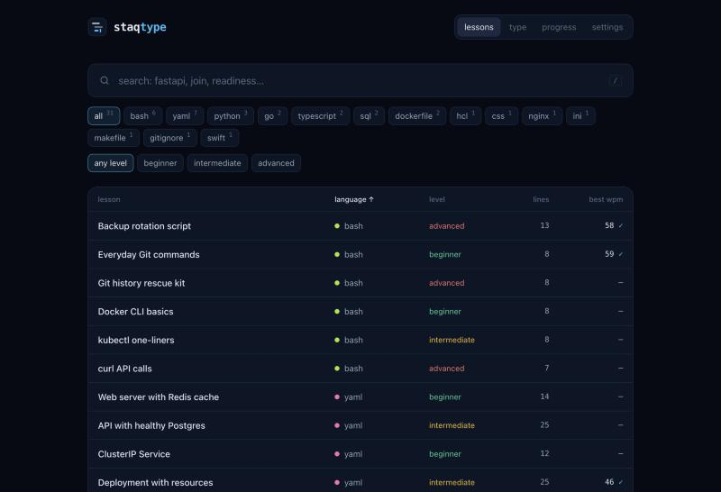

# StaqType

A self-hosted typing trainer for real code. You pick a lesson by language (bash, yaml, python, go, typescript, sql, dockerfile and more) and retype it exactly: every space, tab, bracket and newline is checked, so the practice carries over to your editor. Progress (speed, accuracy, missed keys) stays in your browser; there is no backend and no account. The app works offline after the first visit and can be installed as a PWA.



## Project Structure

```text
.
├── .github/workflows/ci.yml  # checks, install test, releases
├── src/
│   ├── app/                  # app shell and routes
│   ├── features/             # one folder per page
│   │   ├── lessons/          # lessons table with search and filters
│   │   ├── typing/           # typing engine, renderer, result
│   │   ├── progress/         # progress page and its summary
│   │   └── settings/         # settings page, export/import
│   ├── components/           # header, logo, shared UI
│   ├── hooks/                # stored progress and settings
│   ├── utils/                # progress storage, text helpers
│   ├── data/                 # languages and bundled lessons
│   └── types/                # lesson and progress types
├── docs/images/              # README screenshot
├── nginx/default.conf        # static hosting with SPA fallback
├── Dockerfile                # nginx image, non-root, port 8080
├── compose.yaml              # runs the published image
├── CONTRIBUTING.md
├── VERSION
└── LICENSE
```

## Installation

```bash
curl -fsSLO https://github.com/vitlixe/staqtype/releases/latest/download/compose.yaml && docker compose up -d
```

Open `http://localhost:8080`. To run a specific version, start it with `STAQTYPE_VERSION=0.1.0 docker compose up -d`; each release lists its files in `checksums.sha256`. Update with `docker compose pull && docker compose up -d`. The running version is shown on the settings page and at `/VERSION`.

## Usage

- **lessons**: search, filter by language and level, sort the table, click a lesson to start.
- **type**: retype the code. `Esc` restarts, `Shift+Enter` skips to the next lesson in the same language, `Enter` after a finished run opens the next one. `Tab` types the lesson's indentation: a real tab in Go and Makefile lessons, spaces everywhere else. On phones a symbol bar adds Tab, Enter and brackets.
- **progress**: runs, average and best speed, accuracy, a speed chart, progress by language, the keys you miss most and recent runs.
- **settings**: stop on error, Tab width, auto-indent, code size, and export, import or reset of your progress.

## Security Notes

- Everything runs in the browser; the container only serves static files, as a non-root user.
- Progress and settings live in `localStorage` of the browser that opened the app. Export them to move to another machine.

## License

MIT. See [LICENSE](LICENSE).
